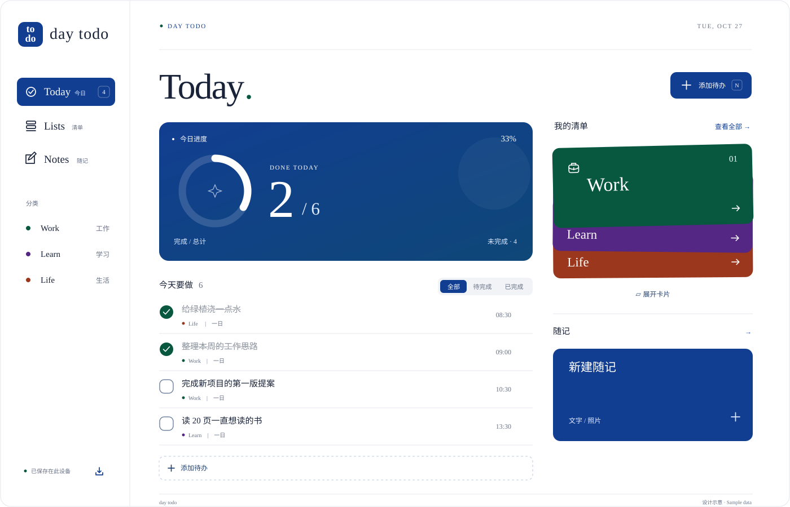
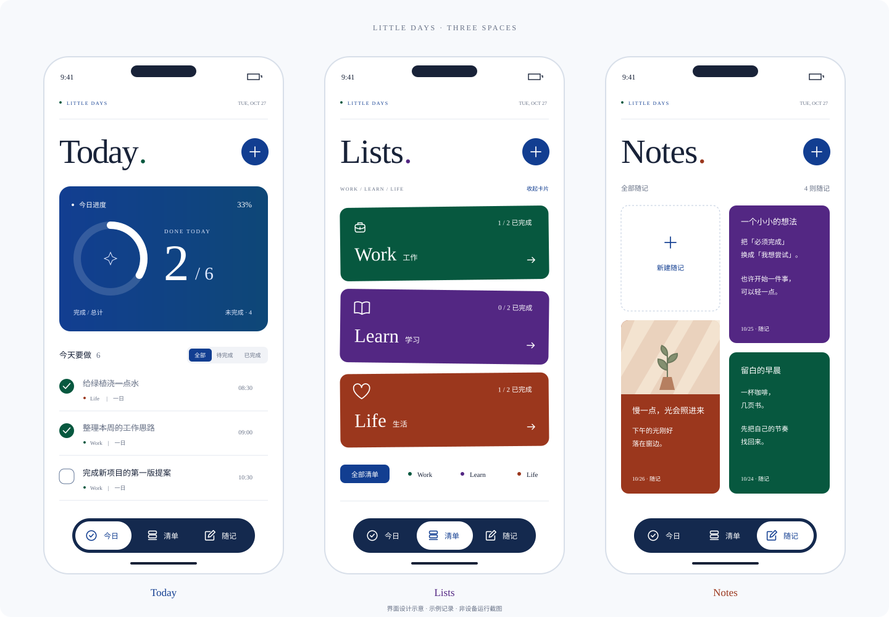

<p align="center">
  
</p>

<h1 align="center">day todo</h1>

<p align="center">记录工作、学习与生活中的待办和随记。</p>

<p align="center">
  <strong>Web / PWA · Android · iPhone</strong><br>
  一套共享界面，本地保存，可导出备份。
</p>

<p align="center">
  <a href="https://little-days-todo-m7q2.shouuu336.chatgpt.site/#today"><strong>打开网页版</strong></a> ·
  <a href="#手机安装与下载">手机安装与下载</a> ·
  <a href="#界面概览">界面概览</a> ·
  <a href="#快速开始">快速开始</a> ·
  <a href="#手机端工程">手机端工程</a> ·
  <a href="docs/RELEASE.md">构建与发布</a> ·
  <a href="docs/DATA.md">数据备份</a>
</p>

## 手机安装与下载

<p align="center">
  <a href="https://github.com/swaggyer/Todo/releases/download/android-preview-1.0.1/day-todo-android-preview.apk"><strong>下载 day todo Android 测试版 APK</strong></a>
</p>

用手机浏览器打开上面的链接即可下载，无需登录 GitHub，也无需解压。下载完成后打开 `day-todo-android-preview.apk`，按手机提示确认安装。浏览器不能跳过系统安装确认。

Android 为调试签名的测试包，尚未完成真机验证。后续版本可能无法覆盖安装；更换版本或卸载前先在应用内导出备份。网页与 App 数据各自保存在本机，不会自动同步。详细步骤见[手机安装说明](docs/INSTALL.md)。

## 界面概览

纯白画布，深色高饱和卡片。英文使用 Times New Roman，中文使用系统黑体。

应用名称为 **day todo**，图标以深钴蓝底色搭配白色 `to / do` 字母组合。1.0.1 更新名称与图标，保留已有清单、随记和数据格式。

**界面概览（设计示意）**：以下插图依据当前界面布局绘制，用于说明信息结构，不是应用运行截图。



<p align="center">
  
</p>

手机示意图展示 Today、Lists 与 Notes 的页面结构。Android 与 iPhone 工程复用相同的界面源码。

## 功能

| 区域 | 可以做什么 |
| --- | --- |
| **Today · 今日** | 汇总当天有效待办，以进度环、滚动数字和变化的背景展示完成情况 |
| **Lists · 清单** | 用 Work / Learn / Life 分类；选择一日、一周或自定义日期范围 |
| **Notes · 随记** | 保存文字、照片与灵感，为随记选择卡片颜色 |
| **数据备份** | 导出包含照片的 JSON 备份，在另一浏览器或手机端导入 |

完成与撤销、对勾和粒子反馈、惯性时间滚轮，以及分类卡片的展开与收起，均由共享界面实现。手机端另外配置了原生拍照、触觉反馈和备份分享适配。

**周期规则：**“一周”和“自定义”表示一条事项的有效日期范围。区间内每天出现在 Today，完成一次即完成整条事项；它不是每天自动重置的循环任务。

## 版本与状态

| 平台 | 项目内容 | 当前验证范围 |
| --- | --- | --- |
| **Web / PWA** | 静态网站、桌面图标、manifest 与离线缓存 | 已完成构建和浏览器主要交互检查 |
| **Android** | Capacitor 原生工程、Gradle Wrapper、系统能力适配 | 1.0.1 已成功编译并发布 APK，名称与图标已核验；真机测试待执行 |
| **iPhone / iPad** | Xcode 工程、Swift Package Manager、权限与隐私声明 | 工程已生成并同步；原生编译与真机测试待执行 |

仓库提供完整源码和构建流程，以及上述 Android 调试签名测试包；尚未提供正式签名分发包。详细记录见 [验证范围](docs/VALIDATION.md)。

## 快速开始

准备 **Node.js 24** 与 **pnpm 11.25.0**：

```sh
git clone https://github.com/swaggyer/Todo.git
cd Todo
pnpm install --frozen-lockfile
pnpm build
pnpm dev
```

打开终端显示的地址，默认是 `http://127.0.0.1:4174`。修改 `packages/ui` 后，重新执行 `pnpm build` 并刷新页面。

### 常用命令

| 命令 | 用途 |
| --- | --- |
| `pnpm dev` | 启动本地网页预览 |
| `pnpm check` | 检查语法、资源、manifest、原生配置和数据兼容性 |
| `pnpm build` | 构建网页及手机端共享资源 |
| `pnpm mobile:sync` | 构建资源并同步至两个原生工程 |
| `pnpm mobile:android` | 同步后在 Android Studio 打开工程 |
| `pnpm mobile:ios` | 同步后在 Xcode 打开工程，需要 Mac |
| `pnpm package` | 生成源码 ZIP、网页 ZIP 与 SHA-256 校验文件 |

网页版输出到 `apps/web/dist`，可将目录中的完整内容部署到 HTTPS 静态托管服务。部署、PWA 安装及离线缓存说明见 [Web 文档](docs/WEB.md)。

## 手机端工程

原生容器使用 **Capacitor 8**，应用标识保留为 `com.swaggyer.littledays`，用于维持原有应用与本地数据身份。

**Android**：准备 Android Studio、Java 21 和 Android SDK，然后执行：

```sh
pnpm mobile:android
```

**iPhone / iPad**：在安装 Xcode 26+ 的 Mac 上执行：

```sh
pnpm mobile:ios
```

原生工程分别位于 `apps/mobile/android` 和 `apps/mobile/ios/App/App.xcodeproj`。调试 APK、iOS 模拟器应用与真机签名包是不同产物；编译、权限验证和签名步骤见 [手机端文档](docs/MOBILE.md)。

## 项目结构

```text
day-todo/
├── apps/
│   ├── web/                    网页入口与构建产物
│   └── mobile/
│       ├── android/            Android 原生工程
│       ├── ios/                iOS 原生工程
│       ├── src/                原生能力适配
│       └── capacitor.config.json
├── packages/
│   └── ui/                     共用的 HTML、CSS、JavaScript 与资源
├── scripts/                    构建、预览、检查与打包
├── docs/                       说明文档与界面示意图
├── .github/workflows/          CI 与手动构建流程
├── pnpm-workspace.yaml
├── pnpm-lock.yaml
└── package.json
```

界面保持原生 JavaScript 实现，网页和两个手机端从 `packages/ui` 构建，避免维护三份重复界面。

## 自动检查与打包

- **CI**：在 `main` 更新或 Pull Request 时运行源码检查和构建。
- **Android download**：供开发时手动构建调试 APK，Actions 产物保存 14 天；首页下载按钮使用单独保存的 Release 附件。
- **Build packages**：在 [Actions](https://github.com/swaggyer/Todo/actions) 手动触发，分别构建网页 ZIP、Android 调试 APK 和未签名的 iOS 模拟器应用。
- **本地打包**：运行 `pnpm package`，产物保存到 `artifacts`。

保留的构建工作流不会自动发布网站、创建 Release 或上传应用商店。首页的 APK 使用公开 Release 附件，临时发布流程不作为常驻任务保留。构建结果与分发记录见 [构建与发布](docs/RELEASE.md) 和 [验证范围](docs/VALIDATION.md)。

## 数据与隐私

网页版已公开开放，无需 Codex 或 ChatGPT 账号。每位访问者的本机记录独立保存，公开页面不会公开个人待办与照片。

数据保存在当前浏览器或手机应用中，应用不要求账号，也不会自动上传待办与照片。Web、Android、iPhone 各自保存数据，**没有跨设备自动同步**。

正常刷新、关闭后重开及同域名的网站更新不会主动清空已保存记录。Today 跨天后会按日期筛选，过去事项仍可在 Lists 查看。

换设备、改域名、清理浏览器数据或卸载应用前，可从“数据备份”导出 JSON，再在目标设备导入。格式与合并规则见 [数据备份与迁移](docs/DATA.md)。

## 文档

| 文档 | 内容 |
| --- | --- |
| [Web / PWA](docs/WEB.md) | 部署、安装与离线缓存 |
| [Android 与 iPhone](docs/MOBILE.md) | 环境、原生编译、权限和签名 |
| [数据备份](docs/DATA.md) | 导出、导入与设备迁移 |
| [源码结构](docs/ARCHITECTURE.md) | 共用源码与维护方式 |
| [构建与发布](docs/RELEASE.md) | GitHub Actions 和交付产物 |
| [验证范围](docs/VALIDATION.md) | 已完成检查与待验证项目 |
| [第三方组件](THIRD_PARTY_NOTICES.md) | 依赖及授权信息 |
| [参考资料](docs/REFERENCES.md) | 官方文档与项目组织参考 |
